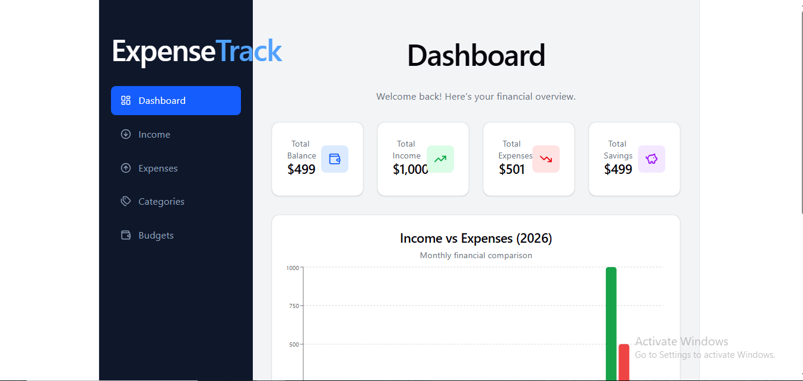

# Expense Tracker System

A full-stack Expense Tracker application built to manage personal finances, track income and expenses, organize categories, and monitor budgets.

## Features

- **Dashboard:** View financial summaries and charts.
- **Income Management:** Add, view, edit, and delete income records.
- **Expense Management:** Track and manage daily expenses.
- **Category Management:** Organize income and expenses into categories.
- **Budget Management:** Create and manage spending budgets.
- **REST API:** Backend API built with ASP.NET Core Web API.
- **Database Integration:** Store application data using SQL Server.

## Tech Stack

**Frontend**
- React.js
- Vite
- Tailwind CSS
- JavaScript

**Backend**
- ASP.NET Core Web API (.NET 9)
- Entity Framework Core

**Database**
- Microsoft SQL Server

## Project Structure

```text
ExpenseTracker/
├── backend/
│   └── ExpenseTracker.API/
│       ├── Controllers/
│       ├── Models/
│       ├── Data/
│       └── ...
├── public/
├── src/
├── package.json
├── vite.config.js
└── README.md
```

## Getting Started

### Prerequisites

- Node.js and npm
- .NET 9 SDK
- Microsoft SQL Server
- Visual Studio Code (recommended)

### 1. Clone the Repository

```bash
git clone https://github.com/shahfaisal3863/ExpenseTracker.git
cd ExpenseTracker
```

### 2. Configure the Database

Configure your SQL Server connection string in the backend's local `appsettings.json` file.

Example:

```json
{
  "ConnectionStrings": {
    "DefaultConnection": "YOUR_SQL_SERVER_CONNECTION_STRING"
  }
}
```

Make sure the connection string key matches the one used in your backend code.

### 3. Run the Backend

```bash
cd backend/ExpenseTracker.API
dotnet restore
dotnet run
```

Open Swagger using the API URL printed in your terminal, followed by `/swagger`.

### 4. Run the Frontend

Open another terminal in the project root directory:

```bash
npm install
npm run dev
```

Open the local URL displayed by Vite in your browser.

## API

The backend provides REST API endpoints for managing:

- Categories
- Income
- Expenses
- Budgets
- Dashboard Summary

## Screenshots

### Dashboard



## Future Improvements

- User authentication
- Responsive UI enhancements
- Advanced financial reports
- Export reports to PDF or Excel

## Author

**Shah Faisal**

GitHub: [@shahfaisal3863](https://github.com/shahfaisal3863)

---

If you find this project useful, feel free to explore the repository and share your feedback.
